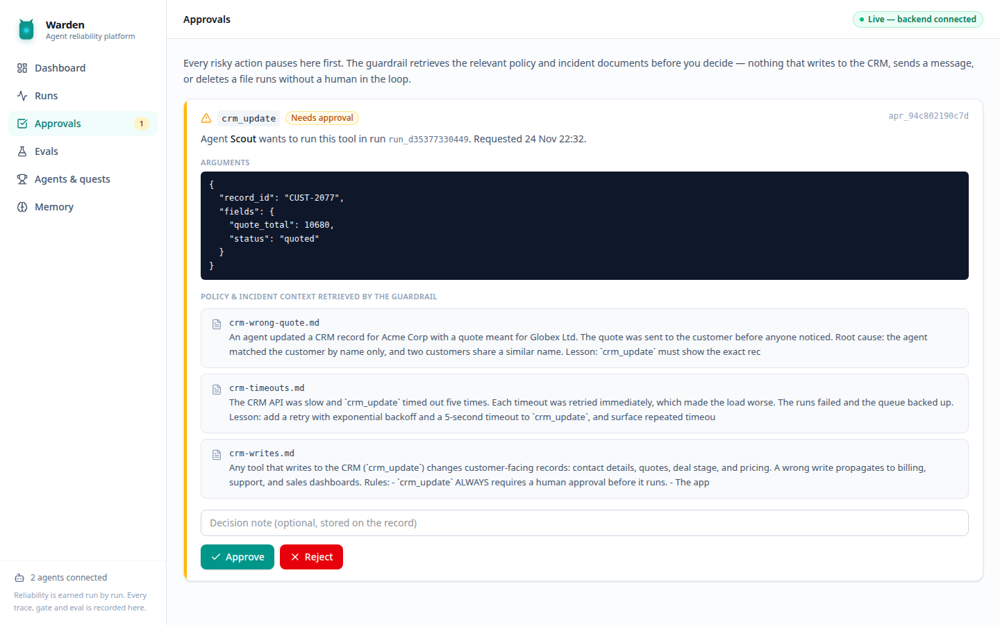

# Warden

<video src="assets/warden-intro.mp4" width="100%" autoplay muted loop playsinline></video>

**The agent reliability platform.** Warden is the infrastructure that lets teams trust AI agents with real work.

Agents fail silently in production — they loop, call the wrong tool, lose state on a crash, or take an unsafe action — and teams have no replay, no evals, and no approval gate. Warden fixes that: durable execution with checkpoints, a full trace viewer, persistent memory, human-approval gates with policy retrieval, a nightly eval suite that blocks bad deploys, and a gamified dashboard that turns every failure into a quest.

> All runs, traces, memories, and eval results in this repo are **synthetic demo data**, generated locally by the demo agents. Nothing is presented as real production traffic.

## Screenshots

| Dashboard | Trace view |
|---|---|
|  |  |

| Approval queue | Eval suite |
|---|---|
|  |  |

## What Warden does

- **Durable execution** — Agents run as graphs with state checkpoints persisted in SQLite. A run survives a restart and resumes from its checkpoint. Proven by test (`test_checkpoint_resume.py`).
- **Demo agents that do real multi-step work** — *Scout*, a research/ops agent (web search, web fetch, calculator, file writer, mock CRM), and *Planner*, which plans a task and hands off to Scout as its executor, sharing state. Both run on a local deterministic model, so the platform runs fully offline; any LangChain chat model can be plugged in.
- **Trace viewer** — Every run records a full trace: each node, each LLM decision, each tool call with inputs/outputs, timings, token and cost estimates, and every approval gate. List runs, inspect a trace, and **replay** it against the current agent version to check it still reproduces.
- **Persistent cross-session memory** — The agent remembers facts and preferences across sessions (stored, retrievable, editable via API). Retrieval is RAG-based (BM25 over stored memories).
- **Safety guardrails** — Human-approval gates: the agent **pauses** and asks a human before a risky action (CRM write, sending a message, deleting a file). Before deciding, the guardrail retrieves the relevant policy and past incidents (RAG over a small policy/incident corpus). Spend/token limits and an iteration cap halt the agent; loop detection stops repeated tool calls. Approval queue API: approve / reject with a note.
- **Nightly eval suite** — Replays a fixed set of 8 recorded scenarios against a new agent version, scores regressions (success rate, tool-call correctness, cost), and **blocks the deploy** if the success rate drops more than 10 points or a critical scenario fails. A deliberately weakened candidate (calculator removed) is included to prove the blocking works.
- **Failure analysis** — Recorded traces are cleaned and parsed into the top failure modes (loop, timeout, rejected gate, spend limit…), each with an incident quest attached. Eval datasets are built from real traces.
- **Gamified dashboard** — A single reliability score with a trend, runs, success rate, cost, streaks, a leaderboard of agents by reliability, levels (Fragile → Hardening → Battle-tested → Production-grade), and incident quests that award XP when a failure mode is fixed.
- **Demo mode** — If the backend is unreachable, the frontend clearly switches to a labelled demo mode with mock data, instead of failing silently.

## Quickstart

```bash
# Backend (Python 3.12)
cd backend
python -m venv .venv && source .venv/bin/activate
pip install -r requirements.txt
uvicorn app.main:app --port 8000
# API docs: http://localhost:8000/docs

# Frontend (Node 20+)
cd frontend
npm install
npm run dev        # http://localhost:5173
```

Or with Docker Compose (see below):

```bash
docker compose up --build
```

The backend seeds demo memories, quests, and a few demo runs on first start. Try it:

```bash
# Start a run that will pause at the approval gate
curl -X POST http://localhost:8000/api/runs \
  -H 'Content-Type: application/json' \
  -d '{"agent_id": "scout", "task": "Research vendor Acme Corp, compute the total for 50 seats at $49 each, save a summary and update the CRM record with the quote."}'
# → status: awaiting_approval, with a pending_approval (tool: crm_update, policy refs attached)
# Approve it from the Approvals view, or:
curl -X POST http://localhost:8000/api/runs/<run_id>/approve \
  -H 'Content-Type: application/json' \
  -d '{"approval_id": "<approval_id>", "note": "verified the quote"}'
```

## Measured results

Measured 2026-11-24 on this machine (local deterministic model, no external LLM). Full detail in [`docs/EVAL.md`](docs/EVAL.md) and [`backend/eval/results.json`](backend/eval/results.json).

**Tests — 19 passed, 0 failed** (`cd backend && pytest`):

| Suite | Tests |
|---|---|
| Checkpoint / resume | crash mid-run, resume from checkpoint, replay reproduces |
| Approval gate | gate pauses, approve resumes, reject blocks, rejected tool never runs |
| Eval regression blocking | current passes, degraded is blocked |
| Trace recording | steps, timings, tokens, cost recorded |
| Memory | add / retrieve (BM25) / update / delete |

**Eval suite — 8 fixed scenarios, measured:**

| Candidate | Verdict | Success rate | Scenarios | Baseline delta | Duration |
|---|---|---|---|---|---|
| current | **pass** | 1.000 | 8 / 8 | 0.000 | 18.4 s |
| degraded (calculator removed) | **blocked** | 0.375 | 3 / 8 | −0.625 | 11.0 s |

The degraded candidate fails 5 of 8 scenarios (including the critical research + quote and CRM-gate scenarios) and is correctly blocked from deploying. Per-scenario tool correctness for the current candidate is 1.0 on 6 of 8 scenarios; the two exceptions are the intentional graceful-failure scenarios (flaky search: 0.0 — the tool is *supposed* to fail; CRM timeout: 0.75 — the run recovers without a false success).

**Live dashboard (seeded demo data, production runs only):** reliability score **80** (Battle-tested), 5 runs, 80% success rate, $0.01 estimated cost. Eval runs are excluded from the dashboard stats — they are test traffic, not production runs.

## API

Full contract in [`docs/API.md`](docs/API.md). Highlights:

| Endpoint | What it does |
|---|---|
| `GET /health` | status, agents, run count |
| `POST /api/runs` | start a run (201; `awaiting_approval` if it hits a gate) |
| `GET /api/runs`, `GET /api/runs/{id}` | list runs / run detail + full trace + checkpoints |
| `GET /api/runs/{id}/trace`, `/checkpoints` | trace steps / LangGraph checkpoints |
| `POST /api/runs/{id}/approve`, `/reject` | resume a paused run |
| `POST /api/runs/{id}/replay` | replay the recorded trace, report divergences |
| `GET /api/approvals`, `POST /api/approvals/{id}/approve|reject` | the human approval queue |
| `GET/POST/PUT/DELETE /api/memory` | persistent cross-session memory |
| `GET /api/evals`, `POST /api/evals/run` | eval history / run the suite |
| `GET /api/stats`, `/api/failure-modes`, `/api/leaderboard`, `/api/quests` | dashboard, failure analysis, gamification |

Timestamps are ISO-8601 strings; trace step `input` / `output` are JSON strings. Cost is an estimate from reference token rates ($3/1M input, $15/1M output tokens) and a word-count token proxy — it is not a bill.

## Architecture

See [`docs/ARCHITECTURE.md`](docs/ARCHITECTURE.md). In short: FastAPI backend (`backend/app/`) — LangGraph graphs with SQLite checkpoints, a rule-based deterministic demo model, 8 mock tools, a BM25 guardrail (policy + incident RAG) and memory store, an eval suite, and a trace-cleaning analysis layer. React + Vite + Tailwind frontend (`frontend/`) — clean white enterprise design, teal accent, six views (Dashboard, Runs, Approvals, Evals, Agents & quests, Memory), with a labelled demo mode when the backend is down.

## Docker

```bash
docker compose up --build
# backend on :8000, frontend on :5173
```

The compose file is YAML-validated. It has **not** been executed on this machine (no Docker here) — run it where Docker is available and report any issue.

## Limitations (honest)

- **Local deterministic demo model, not a real LLM.** The demo agents run on a rule-based model so the platform works offline. Any LangChain chat model can be plugged in (see `backend/app/agents/model.py`); eval numbers are for the deterministic model, not for a production LLM.
- **Cost and tokens are estimates** (word-count proxy + reference rates), not measured billing.
- **SQLite, single node.** Checkpoints and runs live in local SQLite files. For multi-node production, swap in Postgres + a proper checkpoint store.
- **Docker Compose not executed here** (no Docker on this VM).
- **Mock tools.** The CRM, web search, and file tools are mocks with synthetic data (Acme Corp, Globex Ltd, Initech). They exist to demonstrate the reliability features, not to call real systems.

## License

MIT — see [LICENSE](LICENSE).
