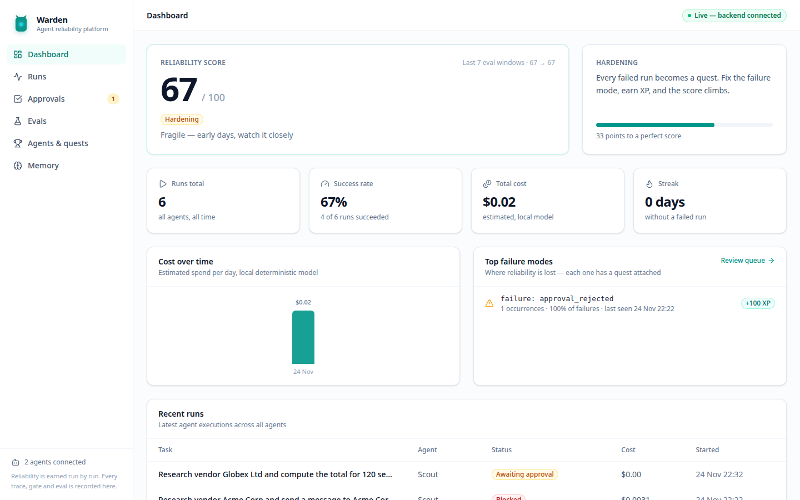
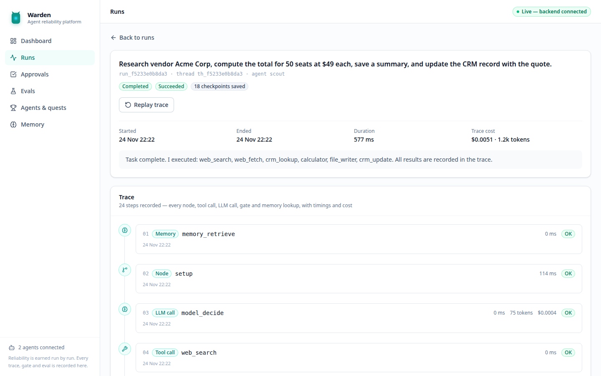
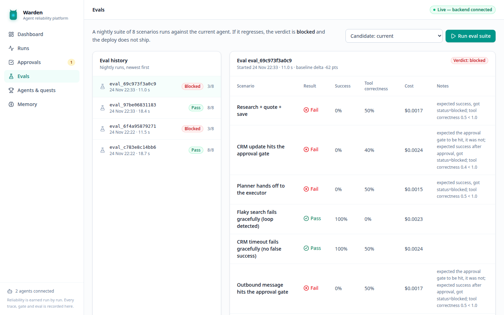

**The agent reliability platform.** Warden is the infrastructure that lets teams trust AI agents with real work.

Agents fail silently in production — they loop, call the wrong tool, lose state on a crash, or take an unsafe action — and teams have no replay, no evals, and no approval gate. Warden fixes that: a real model in the loop behind a provider abstraction, durable execution with checkpoints, live streaming traces, persistent memory that changes decisions, human-approval gates with policy retrieval, a hermetic eval suite that blocks bad deploys, and a dashboard that turns every failure into a quest.

> Seeded runs, traces, memories, and eval results are **synthetic demo data**. When the agent runs with real tools, tool results come from the public web; nothing private is read or written.

## Screenshots

| Dashboard | Trace view |
|---|---|
|  |  |

| Approval queue | Eval suite |
|---|---|
|  |  |

## What Warden does

- **Any model, one interface** — `app/llm.py` resolves a provider from configuration: OpenAI, Anthropic, a local Ollama server (via its OpenAI-compatible endpoint), or the offline deterministic model. `WARDEN_LLM=auto` picks the best available. A provider you configured explicitly is **never silently downgraded** — if it fails, the run fails with `failure_reason="model_error"`, because a silent fallback would make eval numbers lie. Model calls are retried with traced exponential backoff.
- **Real tools, safely** — live web search (Tavily → Brave → DuckDuckGo HTML, no key required), HTTP fetch with HTML→text extraction, arithmetic, a sandboxed file writer, and a stateful local CRM. `web_fetch` re-validates **every redirect hop** against `assert_public_url`: loopback, private, link-local (cloud metadata), reserved, multicast and IPv4-mapped IPv6 addresses are refused, bodies are size-capped and schemes restricted to http(s). `WARDEN_TOOLS=auto` falls back to clearly labelled mock data on network failure (`source: "mock (fallback: ...)"`), never silently.
- **Background execution + streaming** — `POST /api/runs` returns `202` and a run id immediately; work executes in a bounded worker pool (`WARDEN_WORKERS`, default 4). The UI follows the run over **SSE** (`GET /api/runs/{id}/events`), which replays durable trace rows (so a late or reconnecting client misses nothing) and ends when the run is terminal or paused at a gate.
- **Durable execution** — Runs are LangGraph graphs with state checkpoints in SQLite. Each worker thread owns its checkpointer and compiled graphs (a shared `SqliteSaver` connection is not thread-safe); WAL mode + a 30 s busy timeout let concurrent runs share the file. A run paused at a gate survives a restart and resumes from its checkpoint. A run killed mid-tool-call is marked `failed / process_restart` instead of being replayed, because replaying a node can duplicate a side effect. Proven by tests.
- **Trace viewer with true replay** — Every run records each node, LLM decision, tool call (inputs/outputs), gate, and memory lookup with timings, token estimates and cost. *Verify trace* re-checks the recording against the current plan with no side effects; *Re-run for real* actually executes the task again (tagged `version="replay-*"` so dashboard stats ignore it) and compares tool sequence and outcome.
- **Memory that changes behaviour** — Preferences persist across sessions and are retrieved with BM25 over the stored memories, then injected into the system prompt. The offline model honours a documented subset (e.g. “waive the setup fee” removes the fee from the computed quote) so the effect is testable without a key; a real LLM reads the whole prompt. Retrieval uses `BM25Plus` — classic BM25 IDF goes negative on tiny corpora, which silently disabled memory until there were ~3 rows (a real bug found and fixed here).
- **Safety guardrails** — Before a risky action (CRM write, sending a message, deleting a file) the graph calls `interrupt()` and the run genuinely pauses. The guardrail attaches the policy and past-incident excerpts that justify the gate (BM25 over `backend/policies/` and `backend/incidents/`). Decisions are **idempotent**: a second decision on the same approval returns `409` instead of applying twice. Spend, token and iteration caps plus loop detection halt runaway agents.
- **Hermetic eval suite** — 8 fixed scenarios run with deterministic mock tools so scores do not depend on the network. The suite compares success rate and tool correctness against a stored baseline and **blocks the deploy** if it drops more than 10 points or a critical scenario fails. A deliberately weakened candidate (calculator removed) proves the blocking works.
- **Failure analysis & gamification** — Traces are cleaned and parsed into top failure modes, each with an incident quest; the dashboard shows a reliability score, trend, success rate, cost, streaks, and a leaderboard (Fragile → Hardening → Battle-tested → Production-grade).
- **Demo mode** — If the backend is unreachable, the frontend switches to a clearly labelled demo mode instead of failing silently.

## Quickstart

```bash
cd backend
python -m venv .venv && source .venv/bin/activate   # Windows: .venv\Scripts\activate
pip install -r requirements.txt
cp .env.example .env        # optional — Warden runs offline with no keys
uvicorn app.main:app --port 8000
# API docs: http://localhost:8000/docs

# Frontend (Node 20+)
cd ../frontend
npm install
npm run dev                 # http://localhost:5173
```

To use a real model, put `OPENAI_API_KEY` or `ANTHROPIC_API_KEY` in `backend/.env` (or run Ollama locally with a pulled model). Check `GET /health` — it reports the resolved `provider`, `model`, `live_model`, `tools`, `workers` and `inflight`. The backend also serves the built frontend at `/` when `frontend/dist` exists.

No key? Everything still works: the deterministic model plans and executes the same graphs, and the test suite runs fully offline.

Try the async contract:

```bash
# 1. Queue a run -> 202 immediately
curl -X POST http://localhost:8000/api/runs \
  -H 'Content-Type: application/json' \
  -d '{"agent_id": "scout", "task": "Research vendor Acme Corp and compute the total for 50 seats at $49 each plus a $200 setup fee, then save a summary file."}'
# → {"run_id":"run_...","status":"queued","provider":"deterministic",...}

# 2. Follow it live (Server-Sent Events: step / status / end)
curl -N http://localhost:8000/api/runs/<run_id>/events

# 3. Or block for a demo/script (?wait=N) — pauses at a gate if one is hit
curl -X POST 'http://localhost:8000/api/runs?wait=60' \
  -H 'Content-Type: application/json' \
  -d '{"agent_id": "scout", "task": "Research vendor Acme Corp, compute the total for 50 seats at $49 each, save a summary and update the CRM record with the quote."}'

# 4. Approve the pending gate, then re-execute the task for real
curl -X POST 'http://localhost:8000/api/runs/<run_id>/approve?wait=60' \
  -H 'Content-Type: application/json' -d '{"note":"verified the quote"}'
curl -X POST http://localhost:8000/api/runs/<run_id>/replay \
  -H 'Content-Type: application/json' -d '{"execute":true}'
```

## Measured results

Measured **2026-11-25** on this machine (local deterministic model, real web tools for normal runs, mock tools for evals). Raw eval data: [`backend/eval/results.json`](backend/eval/results.json); detail in [`docs/EVAL.md`](docs/EVAL.md).

**Tests — 61 passed, 0 failed** (`cd backend && python -m pytest -q`, ~43 s):

| Suite | What it proves |
|---|---|
| `test_checkpoint_resume.py` | crash mid-run, resume from checkpoint, replay reproduces |
| `test_approval_gate.py` | gate pauses; approve resumes; reject blocks; rejected tool never runs |
| `test_eval.py` | current candidate passes; degraded is blocked |
| `test_trace.py` | steps, timings, tokens, cost recorded |
| `test_api.py` | 202 + queued, SSE stream (full and incremental), approvals + 409, replay verify/execute, memory CRUD, stats, evals |
| `test_runner.py` | 3 concurrent runs with separate traces; double-submit refused; restart marks mid-flight runs failed |
| `test_llm_provider.py` | auto-resolution order; explicit provider never downgraded; prompt/memory assembly; retry + exhaustion |
| `test_web_tools.py` | SSRF refusal (9 payloads), rebinding protection, markup stripping, DDG parsing, labelled mock fallback |
| `test_memory_effect.py` | memory changes the calculator expression (and is scoped per agent) |

**Eval suite — 8 fixed scenarios, hermetic (mock tools):**

| Candidate | Verdict | Success rate | Scenarios | Baseline delta | Duration |
|---|---|---|---|---|---|
| current | **pass** | 1.000 | 8 / 8 | 0.000 | 3.6 s |
| degraded (calculator removed) | **blocked** | 0.375 | 3 / 8 | −0.625 | 2.4 s |

The degraded candidate fails 5 of 8 scenarios (including the critical research + quote and CRM-gate scenarios) and is correctly blocked. Tool correctness for the current candidate is 1.0 on 6 of 8 scenarios; the two exceptions are intentional graceful failures (flaky search: 0.0 — the tool is *supposed* to fail; CRM timeout: 0.75 — the run recovers without a false success).

**End-to-end checks against the running server** (not unit tests): `202` + `queued`; SSE streaming 17 steps then `status`/`end`; a live DuckDuckGo search returning a real page; approval via `?wait=60` completing with `409` on a second decision; `{"execute":true}` re-running the task with `matches=true` and `version="replay-1.0.0"`; and a stored “waive the setup fee” memory changing the calculator expression from `50.0*49.0+200.0` to `50.0*49.0`.

## API

Full contract in [`docs/API.md`](docs/API.md). Highlights:

| Endpoint | What it does |
|---|---|
| `GET /health` | status, provider, model, tool mode, workers, inflight |
| `POST /api/runs` | queue a run → **202** `{run_id, status:"queued"}`; `?wait=N` blocks for scripts/tests |
| `GET /api/runs/{id}/events` | **SSE** stream of `step`, `status`, `end` (durable; `?after=seq` to resume) |
| `GET /api/runs`, `GET /api/runs/{id}` | list runs / detail + trace + pending approval + checkpoints |
| `GET /api/runs/{id}/trace`, `/checkpoints` | trace steps / LangGraph checkpoints |
| `POST /api/runs/{id}/approve`, `/reject` | decide a gate (202; second decision → 409) |
| `POST /api/runs/{id}/replay` | `{}` verifies the recording; `{"execute":true}` re-runs and compares |
| `GET /api/approvals`, `POST /api/approvals/{id}/approve\|reject` | the human approval queue |
| `GET/POST/PUT/DELETE /api/memory` | persistent cross-session memory |
| `GET /api/evals`, `POST /api/evals/run` | eval history / run the suite |
| `GET /api/stats`, `/api/failure-modes`, `/api/leaderboard`, `/api/quests` | dashboard, failure analysis, gamification |

Timestamps are ISO-8601 strings; trace step `input` / `output` are JSON strings. Cost is an estimate from reference token rates ($3/1M input, $15/1M output) and a word-count token proxy — it is not a bill.

## Architecture

See [`docs/ARCHITECTURE.md`](docs/ARCHITECTURE.md). In short: FastAPI backend (`backend/app/`) — `llm.py` provider abstraction, `runner.py` bounded worker pool, LangGraph graphs with per-thread SQLite checkpointers, real/mock tools with an SSRF guard, BM25Plus memory and policy/incident retrieval, a hermetic eval suite, and a trace-cleaning analysis layer. React + Vite + Tailwind frontend (`frontend/`) — seven views, SSE live trace, replay verification, labelled demo mode.

## Docker

```bash
docker compose up --build
# backend on :8000, frontend on :5173
```

Pass provider keys through the environment (`OPENAI_API_KEY`, `ANTHROPIC_API_KEY`, `TAVILY_API_KEY`, …). The compose file is YAML-validated but has **not** been executed on this machine (Docker daemon not running) — run it where Docker is available and report any issue.

## Limitations (honest)

- **Cloud providers are unit-tested, not exercised here.** No API key exists in this environment, so the live paths in this repo are the deterministic model plus real web tools. The OpenAI/Anthropic/Ollama builders are covered by tests for resolution, failure and no-silent-downgrade behaviour; add a key to validate a real model end to end.
- **The deterministic model is rule-based**, not an LLM. It exists so the platform runs offline and tests are reproducible; per-run model quality with a real provider will differ.
- **No auth, no multi-tenancy.** Anyone who can reach the port can run agents and approve actions. `WARDEN_CORS_ORIGINS` defaults to `*`. Do not expose it publicly.
- **SQLite, single node.** Runs/traces and checkpoints are local SQLite files. Workers are threads in one process; horizontal scale needs Postgres + a shared queue/checkpoint store.
- **Cost and tokens are estimates** (word-count proxy + reference rates), not metered billing.
- **Eval scores use mock tools** so they are network-independent; they measure the agent + platform, not live-tool behaviour.
- **Docker Compose not executed here.**
- **The CRM is local** (synthetic records, in-process state); web tools do reach the public internet.

## License

MIT — see [LICENSE](LICENSE).
